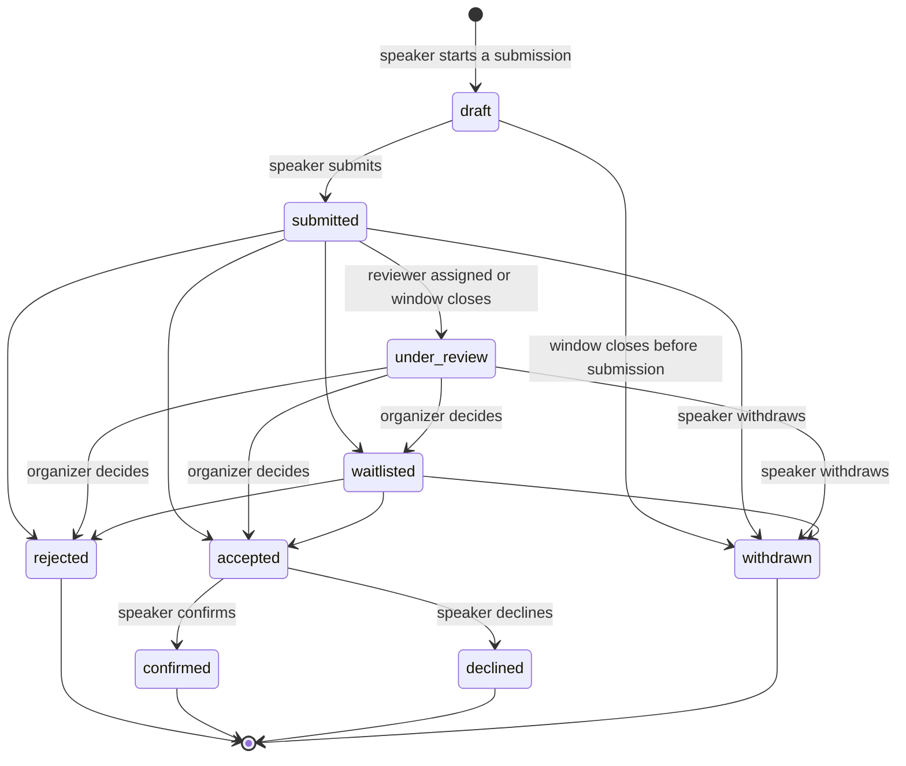
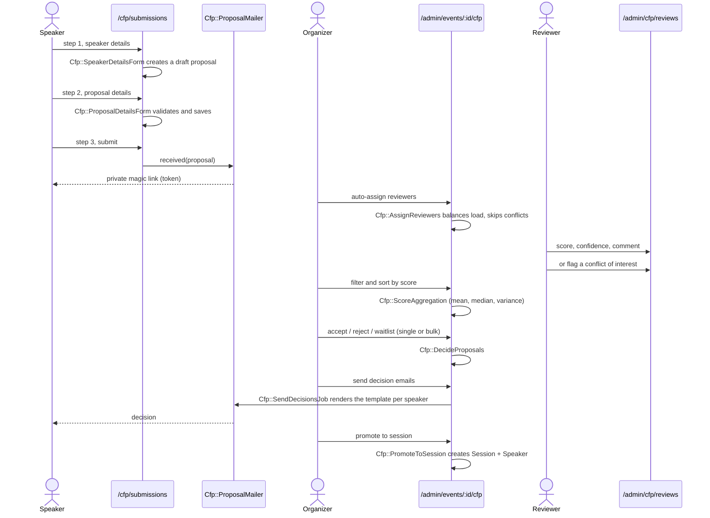

# Call for papers

ConferenceBox can run the call for papers (CFP) of an event in-app instead of linking to an external form. Speakers submit proposals without an account, reviewers score them, organizers decide and accepted proposals become sessions in the schedule.

## Roles

| Role        | Can do                                                                 |
|-------------|------------------------------------------------------------------------|
| `admin`     | Everything, including changing roles on the Team page                  |
| `organizer` | Manage events, run the CFP, assign reviewers, decide, promote, export  |
| `reviewer`  | Only the review queue: score assigned proposals and join the discussion |

Existing users were backfilled as `admin`. New users default to `admin` too, so demote reviewers from `/admin/team_members`.

## Setting up a window

Every event can have one `Cfp::Window` (`/admin/events/:id/cfp/window`). It holds the open and close times, the tracks (one per line), the markdown guidelines, the per-speaker submission limit and the blind review flag.

The public landing page at `/cfp` reflects the window state. The event decorator prefers the in-app CFP over `call_to_papers_url`, which stays as a fallback for conferences that still use an external form.

## Proposal lifecycle

All transitions go through `Cfp::StateMachine.transition`, which validates the move, stamps `submitted_at` / `decided_at` and writes a `Cfp::StatusChange` row for the audit timeline. Anything else raises `Cfp::InvalidTransition`.

## From submission to the schedule

### Submissions

- No account is needed. The proposal token is the only credential, the confirmation email carries the link.
- Speakers can edit or withdraw while the window is open and the proposal is `draft` or `submitted`.
- `max_submissions_per_speaker` is enforced by email, withdrawn proposals do not count.

### Reviews

- Reviewers see only assignments without a conflict flag, on proposals that are still `submitted` or `under_review`.
- With `blind_review` on, reviewers do not see speaker names, emails, companies or bios. Organizers always see them.
- Each reviewer gives a score from 1 (strong reject) to 5 (strong accept) and a confidence from 1 to 3. One review per reviewer per proposal, editable until the decision.
- The internal discussion thread is visible to the whole team and never to the speaker.

### Decisions and emails

- Decisions can be taken from the proposal page or in bulk from the proposals table with an optional note for the timeline.
- Decision emails use an editable template with `{{speaker_name}}`, `{{proposal_title}}` and `{{event_name}}` placeholders, previewed against a real proposal before sending.
- `Cfp::SendDecisionsJob` marks `decision_sent_at` after each email, so re-running it only reaches speakers who have not been emailed yet.

### Promotion

`Cfp::PromoteToSession` creates a `Session` with the proposal title, abstract, track number (position of the track in the window's track list) and a placeholder `09:00` slot sized by the proposal duration. Speakers are matched by email to existing `Speaker` records, or created with the name, company, bio and first link from the proposal. Promotion is idempotent.

## Background jobs and scheduled tasks

| Job                         | Trigger                                   | What it does                                                           |
|-----------------------------|-------------------------------------------|------------------------------------------------------------------------|
| `Cfp::CloseWindowsJob`      | `rake cfp:close_windows` from a scheduler | Withdraws drafts and moves submitted proposals to review once closed   |
| `Cfp::ReviewerReminderJob`  | "Remind reviewers" button                 | Emails each reviewer the number of pending assignments                 |
| `Cfp::SendDecisionsJob`     | Decision emails screen                    | Sends the templated decision to every proposal in the selected status  |

## Exports

The proposals table and the review queue both export CSV through `Cfp::ProposalsCsv`, including speaker details and the aggregated scores.
